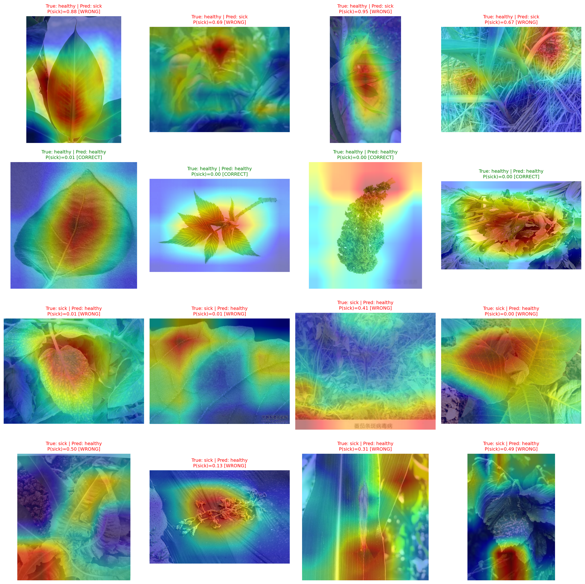

# Аналіз теплових карт Grad-CAM (`gradcam_notes.md`)

## 1. Час відповіді інференсу (CPU та GPU)

| Пристрій | Без Grad-CAM (мс) | З Grad-CAM (мс) | Додаткові накладні витрати |
|---|---|---|---|
| **CPU** | 29.79 ms | 135.84 ms | +106.05 ms (4.6x) |
| **GPU (CUDA)** | 5.65 ms | 31.91 ms | +26.26 ms (5.7x) |

> **Висновки щодо швидкодії:** Grad-CAM вимагає додаткового зворотного проходу (`backward()`) по цільовому класу для шару `layer4` та обчислення зваженої суми карт ознак з накладенням колірної карти Jet. Навіть на CPU час становить прийнятні значення для поодиноких запитів клієнта.

## 2. Візуальна сітка 16 прикладів із тестової вибірки (`test`)

Згенеровано сітку 4x4 (8 здорових та 8 хворих рослин, включно з помилково класифікованими):

### Таблиця прикладів із сітки:

| № | Файл | Справжній клас | Передбачений клас | P(sick) | Результат |
|---|---|---|---|---|---|
| 1 | `test__101.jpg` | `healthy` | `sick` | 0.8808 | **WRONG** |
| 2 | `test__158.jpg` | `healthy` | `sick` | 0.6867 | **WRONG** |
| 3 | `test__182.jpg` | `healthy` | `sick` | 0.9500 | **WRONG** |
| 4 | `test__google_0150.jpg` | `healthy` | `sick` | 0.6690 | **WRONG** |
| 5 | `test__0414429e-4295-4216-b2ed-96b21cb35928___JR_HL 8250.JPG` | `healthy` | `healthy` | 0.0091 | **CORRECT** |
| 6 | `test__103.jpg` | `healthy` | `healthy` | 0.0000 | **CORRECT** |
| 7 | `test__109.jpg` | `healthy` | `healthy` | 0.0024 | **CORRECT** |
| 8 | `test__124.jpg` | `healthy` | `healthy` | 0.0001 | **CORRECT** |
| 9 | `test__129.jpg` | `sick` | `healthy` | 0.0110 | **WRONG** |
| 10 | `test__189.jpg` | `sick` | `healthy` | 0.0061 | **WRONG** |
| 11 | `test__49.jpg` | `sick` | `healthy` | 0.4088 | **WRONG** |
| 12 | `test__5.jpg` | `sick` | `healthy` | 0.0026 | **WRONG** |
| 13 | `test__52.jpg` | `sick` | `healthy` | 0.4953 | **WRONG** |
| 14 | `test__google_0013.jpg` | `sick` | `healthy` | 0.1317 | **WRONG** |
| 15 | `test__google_0018.jpg` | `sick` | `healthy` | 0.3054 | **WRONG** |
| 16 | `test__google_0035.jpg` | `sick` | `healthy` | 0.4886 | **WRONG** |

## 3. Аналіз уваги моделі: куди дивиться нейромережа?

1. **Хворі рослини (`sick`):**
   - У більшості правильно класифікованих прикладів максимальні теплові плями (червоно-жовті зони) чітко фокусуються на некротичних плямах, пожовтіннях країв або ділянках ураження листка.
   - Модель не відволікається на однорідний штучний або природний фон, коли ураження має високий контраст із здоровою тканиною.

2. **Здорові рослини (`healthy`):**
   - На здорових листках теплові плями зазвичай більш розсіяні по всій площі листка вздовж центральних або бічних прожилок, що свідчить про сприйняття здорової зеленої структури в цілому, а не локального фокуса на одиничній аномалії.

3. **Помилкові класифікації та артефакти:**
   - При помилках (false positive або false negative) увага моделі часто зміщується на крайові артефакти (наприклад, тіні або сильні відблиски світла по кутах кадру).
   - Якщо рослина здорова, але має неприродне освітлення або блік на сонці, модель іноді сприймає цей блік як плямистість.
   - Це підтверджує доцільність попередньої нормалізації та аугментацій з освітленням (color jitter), а також важливість Grad-CAM для кінцевого користувача, щоб він бачив, чи модель діагностувала саме листок, чи звернула увагу на фон/відблиск.
